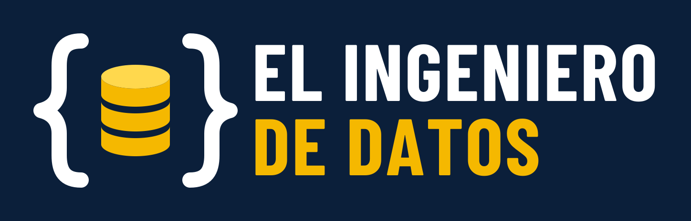

# brand

Identidad visual de **EL INGENIERO DE DATOS**: nombre, lema, logo, colores, tipografía y las piezas a la medida de cada red social.

El logo son unas llaves de código que encierran un cilindro de datos: código y datos, el oficio en una sola forma.



## Nombre y lema

La marca se escribe **siempre en mayúsculas: EL INGENIERO DE DATOS**. Aplica en el sitio, las redes, los documentos y cualquier texto corrido.

- Correcto: EL INGENIERO DE DATOS
- Incorrecto: El Ingeniero de Datos, el ingeniero de datos, EID como nombre público

Lema: **Ensúciate las manos con datos reales.**

Titular descriptivo para el sitio y las bios: "Aprende ingeniería de datos construyendo tu portafolio".

## Qué archivo usar en cada red

Los PNG listos para subir están en [`png/social/`](png/social). El SVG equivalente está en [`social/`](social).

| Red | Pieza | Archivo | Medida |
| --- | --- | --- | --- |
| Todas | Foto de perfil | `avatar-1080.png` | 1080 × 1080 |
| YouTube | Banner del canal | `youtube-banner-2560x1440.png` | 2560 × 1440 |
| YouTube | Base para miniaturas | `youtube-miniatura-plantilla-1280x720.png` | 1280 × 720 |
| YouTube | Marca de agua | `youtube-marca-de-agua-150.png` | 150 × 150 |
| LinkedIn | Banner del perfil | `linkedin-banner-perfil-1584x396.png` | 1584 × 396 |
| LinkedIn | Portada de página | `linkedin-portada-pagina-1128x191.png` | 1128 × 191 |
| Threads e Instagram | Publicación | `instagram-publicacion-1080x1350.png` | 1080 × 1350 |
| Instagram | Historia | `instagram-historia-1080x1920.png` | 1080 × 1920 |
| Spotify y Apple Podcasts | Portada | `podcast-portada-3000.png` | 3000 × 3000 |
| X | Encabezado | `x-encabezado-1500x500.png` | 1500 × 500 |
| Facebook | Portada | `facebook-portada-1640x624.png` | 1640 × 624 |
| Discord | Banner del servidor | `discord-banner-960x540.png` | 960 × 540 |
| GitHub | Vista previa de repos | `github-social-1280x640.png` | 1280 × 640 |
| Sitio web | Imagen al compartir enlaces | `og-image-1200x630.png` | 1200 × 630 |

Notas de uso:

- El avatar deja margen para el recorte circular. Sirve tal cual en YouTube, LinkedIn, Threads, Instagram, X, Discord y GitHub.
- En el banner de YouTube el contenido vive en el área segura central (1546 × 423), que es lo único visible en todos los dispositivos.
- En el banner de LinkedIn el contenido va a la derecha para no quedar debajo de la foto de perfil.
- Las medidas son las recomendadas por cada plataforma al momento de crear el kit; conviene revisarlas si alguna red cambia su diseño.
- El lema de los banners sale de [`scripts/lema.txt`](scripts/lema.txt). Al cambiar ese archivo, los banners se regeneran solos.

## Logo

En [`logo/`](logo) (SVG) y [`png/logo/`](png/logo) (PNG):

| Archivo | Cuándo usarlo |
| --- | --- |
| `eid-logo-horizontal-oscuro` | Versión principal, sobre fondo marino |
| `eid-logo-horizontal-claro` | Sobre fondo blanco |
| `eid-logo-horizontal-transparente-para-oscuro` | Sin fondo, para superficies oscuras |
| `eid-logo-horizontal-transparente-para-claro` | Sin fondo, para superficies claras |
| `eid-logo-vertical-oscuro` | Espacios cuadrados |
| `eid-isotipo-para-oscuro` y `eid-isotipo-para-claro` | Solo el símbolo, sin fondo |
| `eid-icono-app` | Símbolo sobre cuadro marino con esquinas redondeadas |

[`favicon/`](favicon) contiene el favicon del sitio. A 16 px las llaves se empastan, así que el favicon usa solo el cilindro.

## Colores

| Nombre | Hex | Uso |
| --- | --- | --- |
| Marino | `#0B1F3A` | Fondo principal y texto sobre claro |
| Amarillo | `#F5B800` | Acento: cilindro, palabra destacada, botones |
| Amarillo claro | `#FFD84D` | Tapa del cilindro, estados hover |
| Blanco | `#FFFFFF` | Texto sobre marino, fondo claro |
| Niebla | `#C9D3E0` | Texto secundario sobre marino |
| Marino suave | `#17335C` | Tramas y bordes sobre marino |

Reglas de contraste (WCAG):

- Blanco sobre marino: 16.5 a 1. Amarillo sobre marino: 9.2 a 1. Ambos sirven para cualquier tamaño de texto.
- Amarillo sobre blanco: 1.8 a 1. **No usar amarillo como texto ni como enlace sobre fondo claro.**
- Sobre un botón amarillo, el texto va en marino.

## Tipografía

[Barlow Condensed](https://fonts.google.com/specimen/Barlow+Condensed), de licencia abierta (SIL OFL).

- Títulos y logo: Bold, en mayúsculas.
- Texto de apoyo en piezas gráficas: SemiBold.
- Cuerpo de texto en el sitio: [Barlow](https://fonts.google.com/specimen/Barlow).

En los SVG el texto está convertido a trazos, así que no hace falta tener la fuente instalada para usarlos.

## Qué no hacer

- No cambiar los colores ni las proporciones del logo.
- No girarlo, deformarlo ni añadirle sombras o degradados.
- No colocarlo sobre fotos o fondos con poco contraste; usar la versión con fondo marino.
- Dejar alrededor un margen libre de al menos el ancho de una llave.
- No añadir el símbolo ® al nombre mientras la marca no esté registrada.

## Cómo se generan los archivos

Todo sale de [`scripts/build.py`](scripts/build.py): los SVG, los PNG y los favicons. El workflow `.github/workflows/build.yml` corre el script en cada cambio dentro de `scripts/` en `main` y publica los archivos generados en el repo.

Para generarlos en local:

```bash
pip install -r requirements.txt
python scripts/build.py
```

En Linux hace falta `libcairo2`. La primera vez el script descarga Barlow Condensed desde el repositorio de Google Fonts.

Para añadir una pieza nueva, agrega una entrada al diccionario `SOCIAL` del script con su medida y composición.
